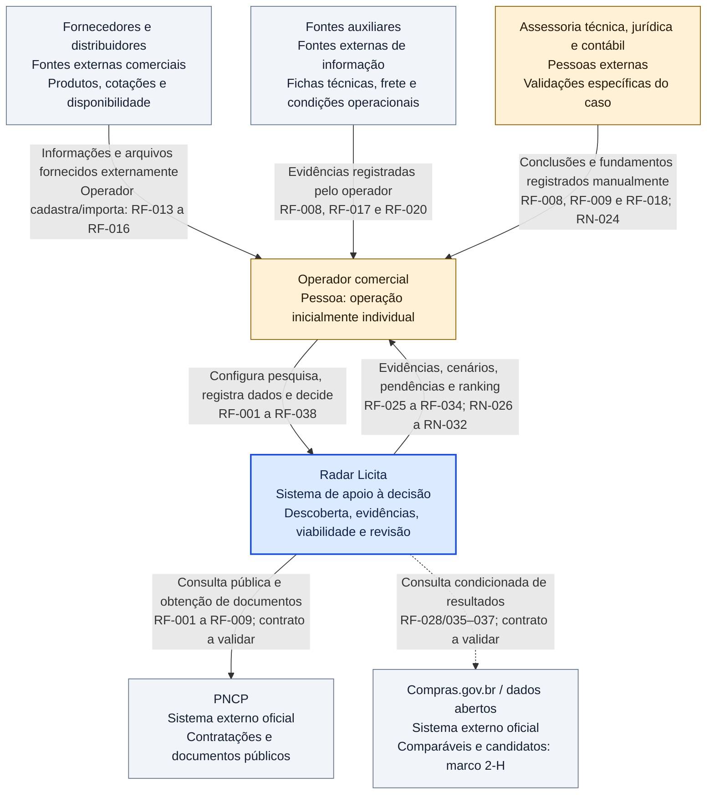

# D01 — Contexto C4 do Radar Licita

Revisão: 0.3-R1-E2, 2026-10-13 (America/Sao_Paulo). Revisado em R1.

Versão: 0.1. Data: 2026-10-10 (America/Sao_Paulo).  
Commit base: `261b32107ff7b053c68c1df98e88de329c41c0f5`.  
Status: [PROPOSTO] — contexto do produto futuro; não representa integração implementada.

## Fonte editável

## Leitura e limites

Este é um diagrama de contexto C4, nível 1, expresso em Mermaid: o Radar Licita aparece como um único sistema, com pessoas e fontes externas ao seu redor. Não define containers, serviços internos ou contratos de API; esses elementos pertencem à Execução 2.

As setas identificam a relação e sua direção principal: o Radar consulta fontes oficiais e recebe suas respostas; fornecedores, fontes auxiliares e assessores entregam informações fora do aplicativo, que o operador registra com procedência. Esses terceiros não possuem acesso direto ao Radar no MVP. A consulta ao Compras.gov.br para histórico é extensão opcional proposta no marco 2-H (ampliação na fase 6), sem pressupor endpoint ou campo já validado.

**Legenda:** azul = sistema em foco; amarelo = pessoa; cinza = sistema/fonte externa. Linha contínua = relação prevista para o MVP, sem afirmar implementação; linha pontilhada = integração opcional condicionada. Todos os elementos futuros estão [PROPOSTO].

O Radar apresenta recomendações para decisão humana. Participação, disputa e demais atos externos são registrados manualmente; nenhuma relação do diagrama representa envio automático de lance/proposta, compra, pagamento ou mensagem a fornecedor/órgão (RN-031). Classe, score e resultado de elegibilidade continuam distintos da situação oficial e do estado comercial (RN-029 e RN-032).

**Rastreabilidade:** [visão de produto](../01-visao-produto.md), [DAN](../03-analise-negocio-dan.md), [RF-001 a RF-038](../04-requisitos-funcionais.md) e [RN-024, RN-026 a RN-032](../06-regras-de-negocio.md). Fonte oficial acessível não equivale a integração implementada nem cobertura nacional completa.

**Validação nesta execução:** revisão textual da fonte e da coerência dos elementos com os documentos 01–06. Não foi localizado renderizador Mermaid no PATH; a renderização automatizada e a validação formal de sintaxe permanecem para a consolidação da Execução 3. O bloco é editável e pode ser visualizado no GitHub com suporte a Mermaid.

## Histórico de revisões

2026-10-13 — 0.3-R1-E2: Escopo Compras antecipado a 2-H condicionado, sem contato automatizado. Validação efetiva no relatório E2; notas de validação antigas referem-se às datas originais.

