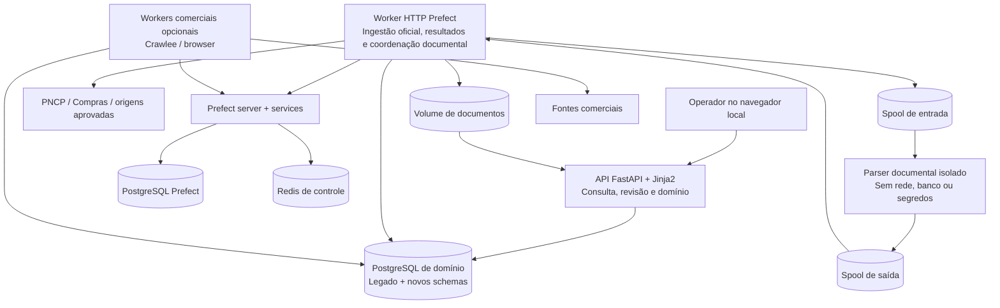

# D02 — Containers C4

Revisão: 0.3-R1-E2, 2026-10-13 (America/Sao_Paulo). Revisado em R1.

Versão: 0.1. Data: 2026-10-11 (America/Sao_Paulo).
Commit base: `261b32107ff7b053c68c1df98e88de329c41c0f5`.
Status: [PROPOSTO] — sem implantação. Fonte editável; validação formal de sintaxe prevista na Execução 3.

Visão de [07](../07-arquitetura-to-be.md), detalhada fisicamente em [D12](D12-implantacao.md). Retângulos representam processos/atores/fontes e cilindros armazenamento. Setas são acesso ou transferência, não sequência. UI Jinja2 pertence à API. Parser é fronteira de contenção, sem banco próprio; API só serve documentos liberados. Redis sustenta Prefect, não cache comercial. RF-001–034; ADR-002–004/012/013; RNF-017/019.

## Histórico de revisões

2026-10-13 — 0.3-R1-E2: Worker/fontes incluem histórico; nenhum container/banco novo pelo incremento. Validação efetiva no relatório E2; notas de validação antigas referem-se às datas originais.

