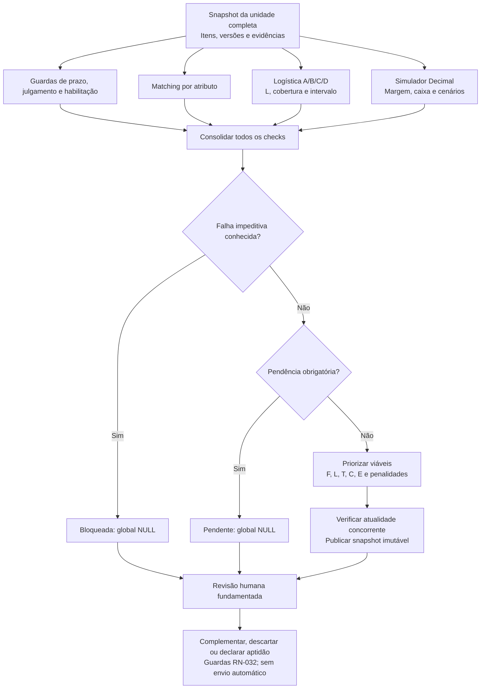

# D03 — Componentes do motor

Revisão: 0.3-R1-E2, 2026-10-13 (America/Sao_Paulo). Revisado em R1.

Versão: 0.1. Data: 2026-10-11 (America/Sao_Paulo).
Commit base: `261b32107ff7b053c68c1df98e88de329c41c0f5`.
Status: [PROPOSTO] — sem implantação. Fonte editável; validação formal de sintaxe prevista na Execução 3.

Retângulos são componentes/saídas; losangos são condições. Revisão não supera trava: nova evidência exige reanálise. Fórmula em [09](../09-motor-de-decisao.md), logística em [11](../11-logistica-e-fornecimento.md), finanças em [12](../12-simulacao-financeira.md). RF-017–027/029; ADR-006/015.

## Histórico de revisões

2026-10-13 — 0.3-R1-E2: Sem impacto no núcleo/fórmula: histórico é contexto fora dos componentes de score; TST-068 verifica invariância. Validação efetiva no relatório E2; notas de validação antigas referem-se às datas originais.

