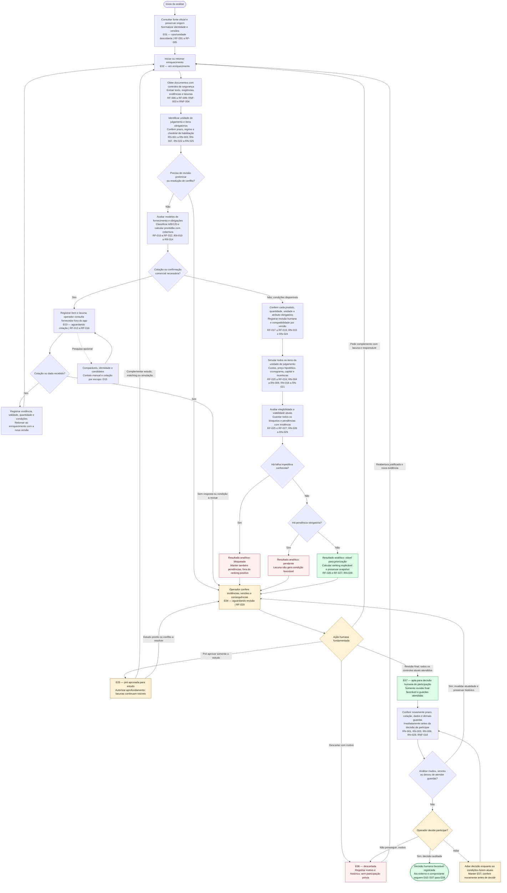

# D07 — Atividades da descoberta à decisão de participar

Revisão: 0.3-R1-E2, 2026-10-13 (America/Sao_Paulo). Revisado em R1.

Versão: 0.1. Data base: 2026-10-10 (America/Sao_Paulo). Retomada: 2026-10-11.  
Commit base: `261b32107ff7b053c68c1df98e88de329c41c0f5`.  
Status: [PROPOSTO] — jornada futura do Radar Licita; nenhuma atividade executada nesta missão.

## Fonte editável

## Leitura e limites

O fluxo de atividades usa a notação Mermaid `flowchart`: retângulos são atividades, losangos são condições/decisões e nós arredondados delimitam início e resultado da jornada. Amarelo destaca intervenção humana; vermelho identifica resultado impedido ou descarte; verde indica priorização/decisão condicionada às guardas. Os textos e formas preservam o significado sem depender de cor. Os códigos E01–E08 referenciam os estados de [RN-032](../06-regras-de-negocio.md#rn-032--máquina-de-estados-comerciais) e [D10](D10-estados.md); atividades internas não criam estados comerciais adicionais.

O percurso cobre descoberta, documentos, julgamento, logística, fornecedores, matching, finanças, bloqueios, ranking e decisão humana. Revisão preliminar permite orientar o estudo, sem liberar participação. Todos os ramos que chegam à revisão compartilham a mesma guarda para E04 → E07: resultado atual sem bloqueio nem pendência obrigatória, verificações suficientes e revisão final favorável. Chegar à tela de revisão por um ramo incompleto não satisfaz essa guarda. Pré-aprovação E05 pode conduzir a complementação ou voltar a E04; não substitui a análise completa.

O sistema registra a necessidade de cotação e os dados recebidos. O operador consulta fornecedor/assessor fora do aplicativo; nenhuma seta representa envio automático de mensagem. A revisão especializada, quando necessária, é registrada com responsável, escopo, fonte e data. Recusa/erro de download, extração incompleta, fonte indisponível, prazo ambíguo e atributo técnico ausente permanecem como pendências; falha impeditiva conhecida prevalece no resultado analítico, sem esconder outras lacunas.

Todos os itens obrigatórios precisam ser avaliados. Classe A ou score elevado não dispensam verificação de edital, produto, cotação, capital e habilitação. Classe C admite alternativa local comprovada; classe D conserva a falta crítica. A simulação distingue referência oficial de preço hipotético e calcula o caixa da unidade completa, sem converter ausência em custo zero. Sensibilidade ampliada (RF-024, Should) é opcional; os controles obrigatórios e o cenário de atraso continuam exigidos pelas regras de capital.

Ao decidir participar, o operador ainda precisa realizar o ato fora do Radar. O estado permanece E07 até existir comprovação suficiente para registrar E08; a decisão por si só não cria participação. Se a informação mudar ou vencer antes desse ato, a análise volta à revisão. Participação realizada apesar de bloqueio ou fora da sequência prevista exige a reconciliação excepcional auditada de RN-032/D10, sem aprovar retrospectivamente a análise. O acompanhamento posterior à participação está em D10.

Para manter a leitura, o fluxo mostra o descarte na revisão e na decisão final; D10 também explicita os descartes manuais autorizados a partir de E01, E02, E03 e E05. A ausência dessas setas transversais aqui não restringe nem amplia as transições normativas de RN-032.

**Rastreabilidade:** [01 — visão](../01-visao-produto.md), [03 — DAN](../03-analise-negocio-dan.md), [RF-001 a RF-027 e RF-029 a RF-034](../04-requisitos-funcionais.md), [RN-001 a RN-032](../06-regras-de-negocio.md), [RNF-003 a RNF-005, RNF-008, RNF-015, RNF-016, RNF-018 e RNF-020](../05-requisitos-nao-funcionais.md). Histórico básico RF-028/035–037 é incremento opcional 2-H (ampliação fase 6), contato RF-038 junto de 3 e não é dependência da decisão no MVP.

**Validação na retomada de 2026-10-11:** revisão textual de nomes, guardas, ramos e referências frente aos documentos 01, 03, 04, 05 e 06. Não foi localizado `mmdc` no PATH; não houve renderização nem validação por parser Mermaid. A validação automatizada de sintaxe e a conferência visual ficam pendentes para a consolidação da Execução 3, com fonte editável preservada.

## Histórico de revisões

2026-10-13 — 0.3-R1-E2: Pesquisa de candidatos é ramo opcional de cotação, D15, sem dispensar insumos. Validação efetiva no relatório E2; notas de validação antigas referem-se às datas originais.

