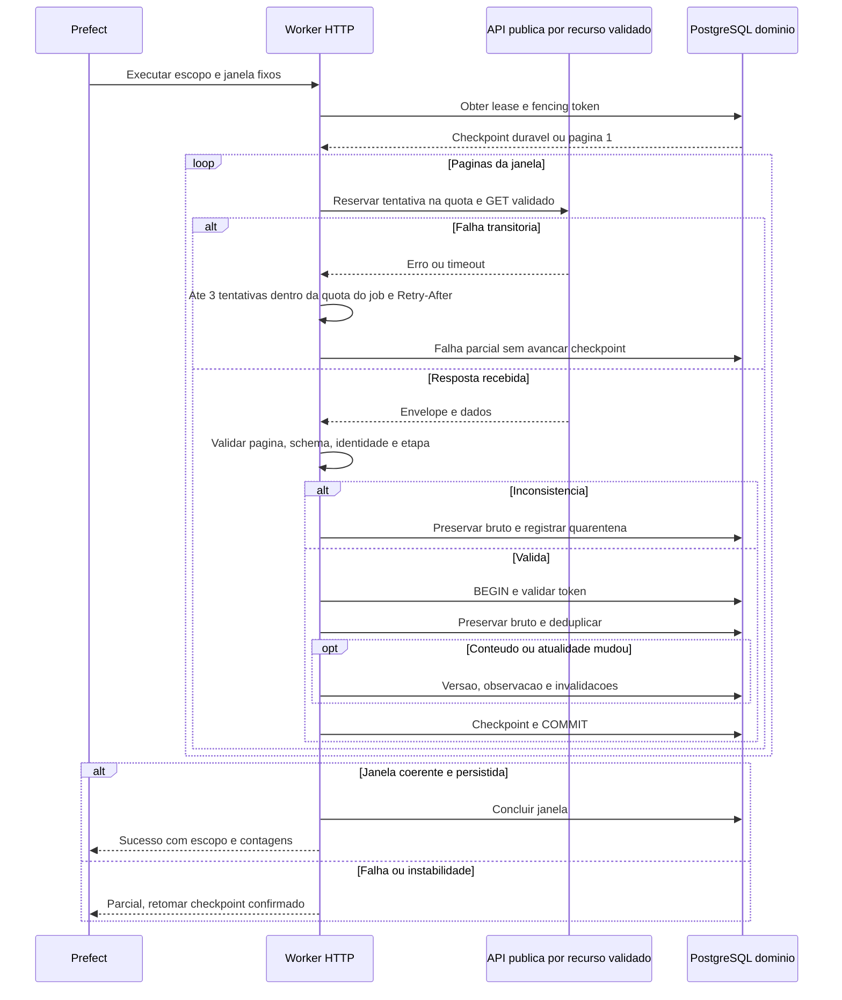

# D08 — Sequência de coleta PNCP

Revisão: 0.3-R1-E2, 2026-10-13 (America/Sao_Paulo). Revisado em R1.

Versão: 0.1. Data: 2026-10-11 (America/Sao_Paulo).
Commit base: `261b32107ff7b053c68c1df98e88de329c41c0f5`.
Status: [PROPOSTO] — sem implantação. Fonte editável; validação formal de sintaxe prevista na Execução 3.

[10](../10-integracoes-pncp.md), RF-001–005, RNF-007/008/018. Falha esgotada interrompe a janela e sai do loop; não repetir indefinidamente. Retomada repete unidade não confirmada, com UNIQUE/fencing contra duplicação. Itens/documentos dependem de contrato ainda pendente; ausência em lista não exclui registros. Setas contínuas=ações, tracejadas=respostas; alt=alternativas, opt=condição. Nenhuma coleta executada.

## Histórico de revisões

2026-10-13 — 0.3-R1-E2: Mesma sequência por recurso validado, quota total e identidade/etapa; E2 não executa coleta. Validação efetiva no relatório E2; notas de validação antigas referem-se às datas originais.

