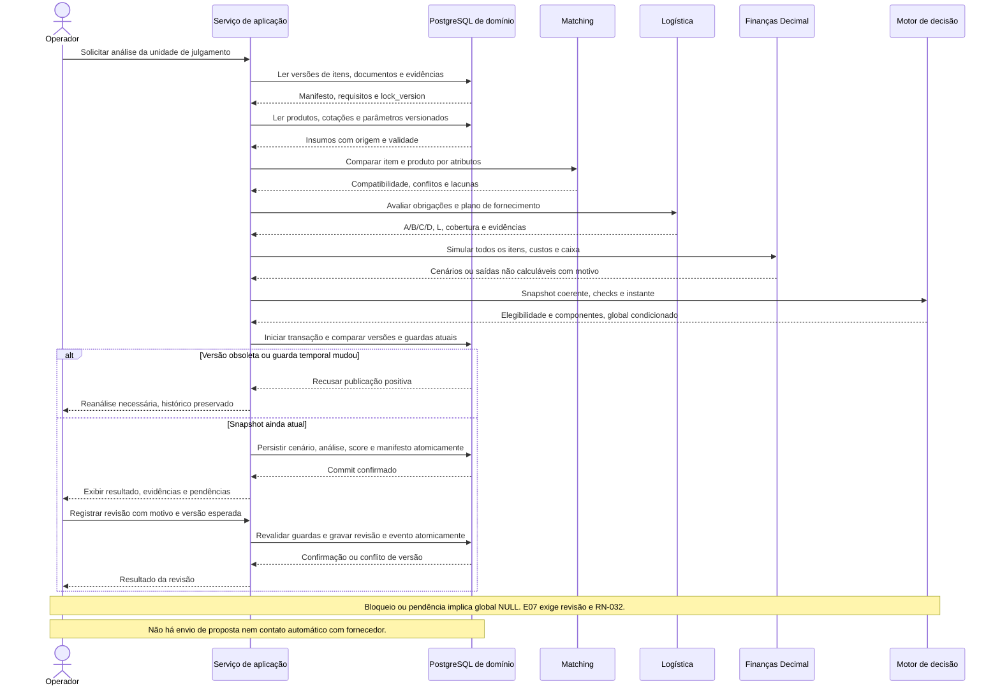

# D09 — Sequência da análise de oportunidade

Revisão: 0.3-R1-E2, 2026-10-13 (America/Sao_Paulo). Revisado em R1.

Versão: 0.1. Data: 2026-10-12 (America/Sao_Paulo).  
Commit base: `261b32107ff7b053c68c1df98e88de329c41c0f5`.  
Status: [PROPOSTO]; fonte editável, sem implementação.

Participantes representam módulos de 07, não novos microsserviços. Documentos e cotações entram por versões já obtidas; análise não faz download oculto. Fonte: [08](../08-modelo-de-dados.md), [09](../09-motor-de-decisao.md), RF-017–027/029/034, RN-028–032.

## Histórico de revisões

2026-10-13 — 0.3-R1-E2: Sem impacto na sequência obrigatória: referência de venda selecionada entra no manifesto; ausência de histórico não bloqueia insumos suficientes. Validação efetiva no relatório E2; notas de validação antigas referem-se às datas originais.

