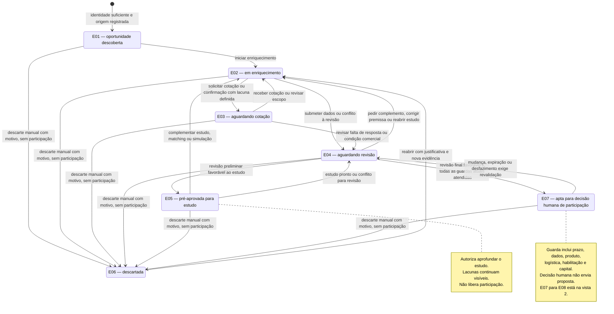
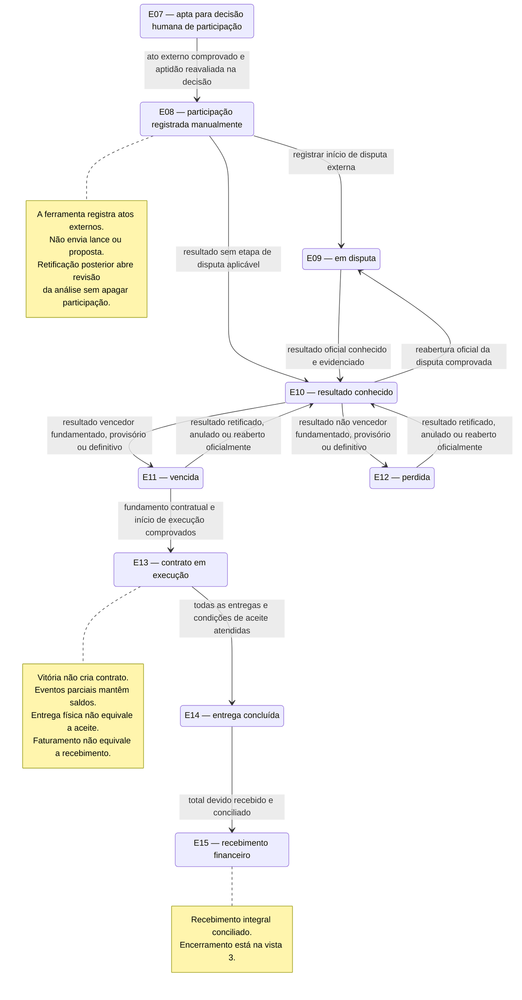
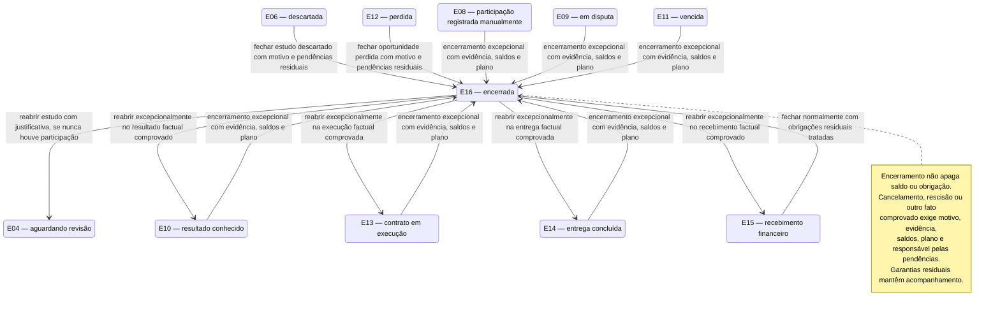

# D10 — Estados comerciais da oportunidade

Versão: 0.1. Data base: 2026-10-10 (America/Sao_Paulo). Retomada: 2026-10-11.  
Commit base: `261b32107ff7b053c68c1df98e88de329c41c0f5`.  
Status: [PROPOSTO] — ciclo comercial futuro; não implementado nesta missão.

## Fonte normativa e legenda

[RN-032](../06-regras-de-negocio.md#rn-032--máquina-de-estados-comerciais) é a fonte normativa dos **16 estados E01–E16** e das guardas. As três vistas Mermaid abaixo representam partes da mesma máquina, com os mesmos identificadores. Uma repetição de E07 ou E16 em outra vista identifica o mesmo estado, sem duplicá-lo nem criar submáquinas.

Retângulo arredondado = estado comercial; seta = transição permitida mediante evento e guarda; círculo inicial = entrada em E01. A legenda de cada seta resume a guarda, cujo detalhe permanece em RN-032. Os nomes são fixados; em particular, **vencida** significa resultado comercial vencedor. Expiração do prazo é condição de elegibilidade, nunca transição para E11. E16 pode ser reaberto nas condições expressas; por isso não há pseudestado final que elimine essa possibilidade.

Situação oficial, elegibilidade, classe logística, score, pendências e estado comercial são dimensões distintas. Nenhum score dispara participação, vitória, contrato, entrega ou recebimento.

## Vista 1 — Descoberta, estudo e aptidão

Reabrir E06 não restaura aprovação anterior: o estudo retorna a E02. O bloqueio analítico também não descarta automaticamente a oportunidade; a transição para E06 exige ação manual com motivo. Pré-aprovação, descarte e aptidão guardam autor, instante, versão, evidências e decisão anterior conforme RN-030.

## Vista 2 — Participação, resultado e execução comprovados

E10 → E11/E12 registra a interpretação do resultado com fundamento e sua condição provisória/definitiva; não presume adjudicação nem contratação. E11 → E13 exige fundamento contratual aplicável e início comprovado. As transições registram fatos; nenhum evento representa compra, assinatura, envio de proposta, pagamento ou comunicação automática pelo Radar (RN-031).

Entregas parciais, recebimentos parciais, adiantamentos comprovados, recusa de entrega, saldo contestado, atraso e revisão posterior à participação são eventos/pendências, sem avanço automático. Entrega parcial mantém E13; recebimento parcial mantém o estado factual e o saldo. Se o total já tiver sido efetivamente recebido antes da entrega completa, conservar a evidência em E13; após o aceite final, E13 → E14 e E14 → E15 podem ser registrados na mesma operação auditada, com dois eventos. O segundo usa o recebimento já comprovado, sem criar pagamento fictício.

Retificação depois de E08 conserva o estágio factual e abre revalidação da análise em paralelo. Um bloqueio novo impede nova recomendação favorável; não força retorno comercial a E04 nem apaga o ato externo. Mudança comprovada do próprio resultado segue E11/E12 → E10; correção de um registro errado exige invalidação/substituição auditada do evento, sem exclusão de histórico.

## Vista 3 — Encerramento e reabertura

Encerramento normal E15 → E16 exige obrigações residuais e garantias resolvidas ou acompanhamento formal registrado. Encerramento excepcional distingue cancelamento, rescisão ou outro fato comprovado e explicita saldos e responsável/plano para pendências; não transforma perdas, dívidas ou obrigações em zero. Reabertura exige nova evidência e o destino factual permitido; uma oportunidade com participação prévia não pode usar E16 → E04 para reconstituir um estudo como se nenhum ato tivesse ocorrido.

## Exceções controladas e integridade

As setas representam as transições comerciais comuns e os encerramentos/reaberturas expressamente previstos. A **reconciliação excepcional** de RN-032 é um caminho de registro distinto: admite fato externo comprovado ocorrido sem uso prévio da ferramenta, inclusive participação feita apesar de bloqueio. Ela não é desenhada como seta irrestrita de qualquer estado para qualquer destino.

| Condição da reconciliação | Registro obrigatório e limite |
|---|---|
| Fato externo ocorrido fora da sequência | Estado de origem, destino factual E08–E15, autor, data real, data de registro, motivo, evidência e sinalização de desvio |
| Participação feita apesar de bloqueio | Preservar bloqueio e histórico; não inventar passagem por E07 nem aprovação retrospectiva |
| Correção de fato registrado incorretamente | Invalidar/substituir evento com justificativa e vínculo ao original; não excluir o histórico |
| Salto sem evidência ou fora das condições | Rejeitar sem alterar estado nem criar fato comercial |

Toda alteração de estado e seu histórico formam uma operação atômica; submissão duplicada não cria dois eventos ativos conflitantes e versão obsoleta exige resolução explícita (RN-030, RNF-005 e RNF-008). A reconciliação existe para registrar realidade comprovada, sem liberar controles de uma nova recomendação.

## Rastreabilidade e validação documental

**Rastreabilidade:** [01 — visão](../01-visao-produto.md), [03 — DAN](../03-analise-negocio-dan.md), [RF-029 a RF-034 e ciclo comercial de 04](../04-requisitos-funcionais.md), [RN-001, RN-003, RN-006, RN-024 e RN-028 a RN-032](../06-regras-de-negocio.md), [RNF-005, RNF-008, RNF-015, RNF-016 e RNF-018](../05-requisitos-nao-funcionais.md). [D07](D07-atividades.md) detalha as atividades que antecedem a decisão de participar.

Verificação documental na retomada de 2026-10-11: comparação textual automatizada dos nomes E01–E16 e dos pares de transição das três vistas contra a tabela de RN-032 encontrou **16 estados com nomes idênticos e 45 transições, incluindo a entrada inicial, sem pares ausentes ou excedentes**. Guardas foram revistas separadamente, incluindo retorno de resultado, pagamento antes da entrega, preservação de fatos após retificação e reconciliação excepcional. Exemplos de coerência: E02 → E13 sem prova é rejeitado; entrega parcial não alcança E14; recebimento parcial não alcança E15; prazo expirado não produz E11. São verificações da especificação, não testes de aplicação.

Não foi localizado `mmdc` no PATH. Não houve renderização nem validação por parser Mermaid; a validação automatizada de sintaxe e a revisão visual permanecem para a consolidação da Execução 3. As três fontes são editáveis e usam `stateDiagram-v2` para visualização em ambiente com suporte a Mermaid.
