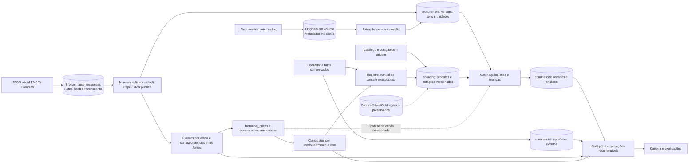

# D11 — Fluxo Bronze/Silver/Gold e dados transacionais

Revisão: 0.3-R1-E2, 2026-10-13 (America/Sao_Paulo). Revisado em R1.

Versão: 0.1. Data: 2026-10-11 (America/Sao_Paulo).
Commit base: `261b32107ff7b053c68c1df98e88de329c41c0f5`.
Status: [PROPOSTO] — sem implantação. Fonte editável; validação formal de sintaxe prevista na Execução 3.

Seta pontilhada=importação opcional validada, nunca conversão automática de histórico. Silver é função de normalização, sem duplicar tabelas procurement/sourcing. Gold não é única cópia das decisões: commercial é autoridade. Backup cobre banco e documentos. [08](../08-modelo-de-dados.md), ADR-014, RF-003/004/014/027/034.

## Histórico de revisões

2026-10-13 — 0.3-R1-E2: Histórico/candidatos no domínio e projeções, Bronze multirrecurso; JSON não exige volume novo. Validação efetiva no relatório E2; notas de validação antigas referem-se às datas originais.

