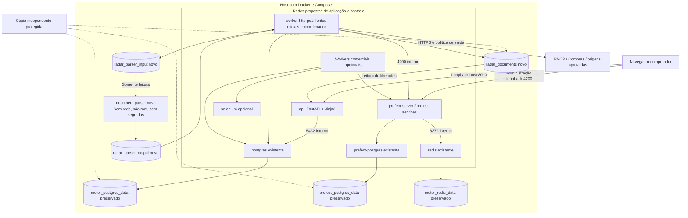

# D12 — Implantação Docker local

Revisão: 0.3-R1-E2, 2026-10-13 (America/Sao_Paulo). Revisado em R1.

Versão: 0.1. Data: 2026-10-11 (America/Sao_Paulo).
Commit base: `261b32107ff7b053c68c1df98e88de329c41c0f5`.
Status: [PROPOSTO] — sem implantação. Fonte editável; validação formal de sintaxe prevista na Execução 3.

Desenho futuro, sem redes/portas alteradas. Detalhes por serviço em [21](../21-infraestrutura-docker.md). Jinja2 no container API; sem frontend separado. Setas contínuas=acesso/fluxo; tracejadas=cobertura de backup/restauração. Redis requer reconciliação de jobs. Parser sem socket Docker. Migração/testes são tarefas efêmeras em 21, com destinos explícitos; testes nunca montam volumes operacionais. ADR-003/004/012/013; RNF-003/004/014/017/019.

## Histórico de revisões

2026-10-13 — 0.3-R1-E2: Sem nova topologia/porta/volume para histórico; rótulo de origem agora inclui Compras, detalhes em 21 §12. Validação efetiva no relatório E2; notas de validação antigas referem-se às datas originais.

