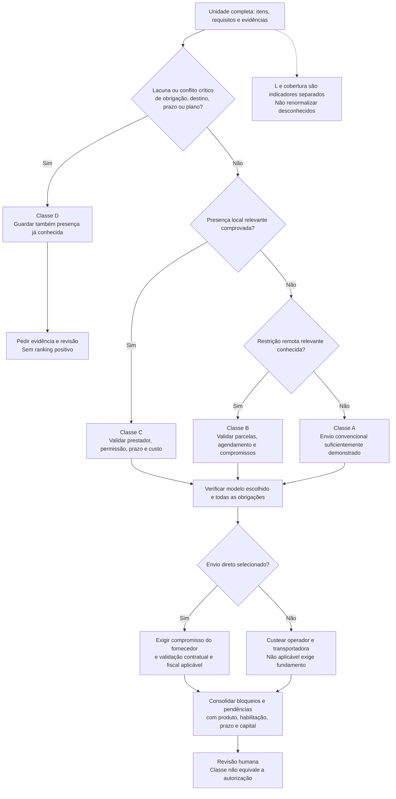

# D13 — Decisão de entrega remota

Versão: 0.1. Data: 2026-10-12 (America/Sao_Paulo).  
Commit base: `261b32107ff7b053c68c1df98e88de329c41c0f5`.  
Status: [PROPOSTO]; fonte editável, sem implementação.

Losangos são condições; a precedência classificatória é D→C→B→A, conforme RN-011 e [11](../11-logistica-e-fornecimento.md). Falha conhecida de execução pode bloquear qualquer classe; presença atendida não torna C automaticamente inviável. L é o limite inferior de v0.1-logistica, não determina classe. RF-010–012/025; TST-010–012/025/050.
