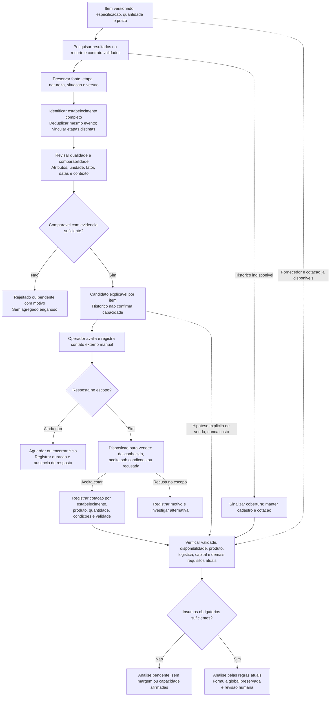

# D15 — Descoberta de fornecedores a partir do histórico público

Revisão: 0.3-R1-E2, 2026-10-13 (America/Sao_Paulo). Revisado em R1.
Commit base: `261b32107ff7b053c68c1df98e88de329c41c0f5`.
Status: [PROPOSTO], marco 2-H e fase 3, condicionado aos gates de fonte/ambiente/piloto.

Legenda: retângulos são atividades/estados informativos, losangos são decisões; setas tracejadas são caminhos opcionais/contexto. Todo contato ocorre fora do sistema e é apenas registrado manualmente. Pendente de comparação não equivale a inaptidão universal do fornecedor. CNPJ completo distingue estabelecimento, raiz apenas agrupa; equivalência de fontes não funde etapas ou cotações de filiais. Não há transição nova de RN-032/D10.

A cotação não reserva estoque. A seta histórico indisponível preserva a análise somente se houver insumos suficientes, não cria informação faltante. Hipótese histórica de venda exige seleção, proveniência, comparabilidade e sensibilidade; nunca vira aquisição. Sem resposta permanece na população e duração observada de MN-14–18. Nenhum passo foi implementado ou executado como piloto nesta revisão.

Fontes normativas: [22](../22-inteligencia-de-mercado-fornecedores.md), [23](../23-especificacao-piloto-fornecedores.md), RF-028/035–038, RN-005/006/033–037, RT-017–019, UC-09, TST-056–071, ADR-018/019/020. Modelo em 08; orçamento/cobertura explícitos, sem coleta nova na E2.

## Histórico de revisões

2026-10-13 — 0.3-R1-E2: D15 criado como fonte Mermaid editável, legenda e limites; validação efetiva registrada no relatório E2.
