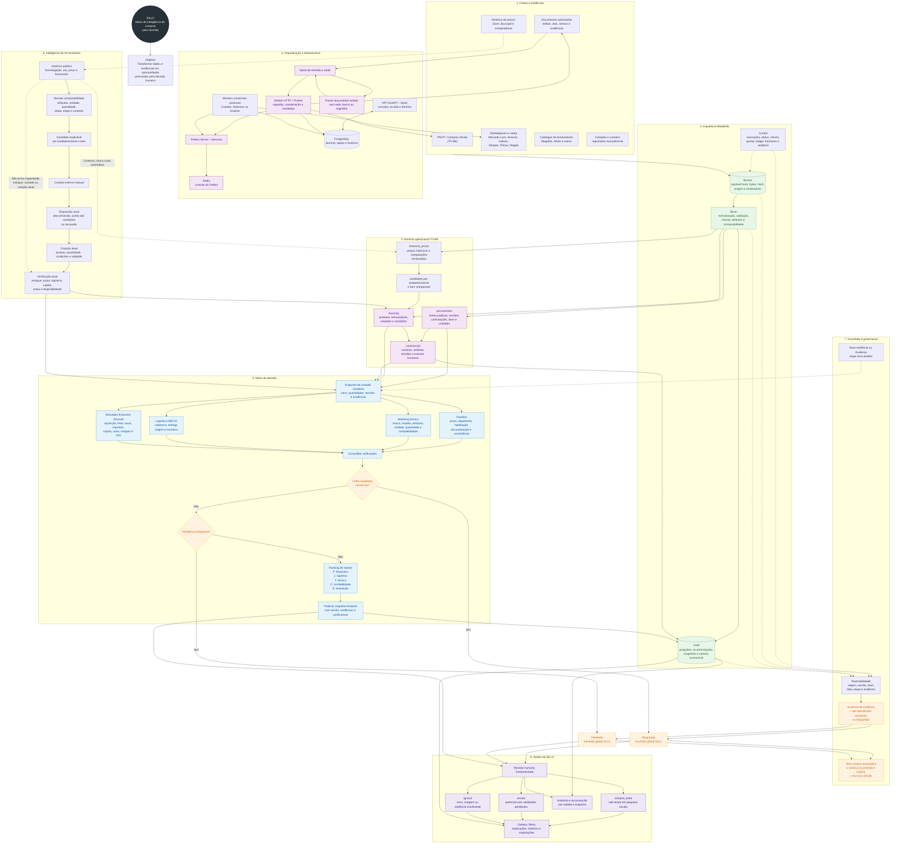

# Mapa conceitual do SILLO

Mapa integrando o motor do SILLO, a arquitetura Medalhão, fontes, orquestração, fornecedores, finanças, ranking e revisão humana.

Os marcadores ajudam a separar o que está documentado como atual do que pertence à arquitetura TO-BE proposta.

## Como interpretar

1. As fontes entram como evidências brutas na Bronze.
2. A Silver normaliza e torna os dados comparáveis.
3. `procurement`, `sourcing` e `commercial` preservam responsabilidades diferentes.
4. O motor combina guardas, matching, logística e finanças.
5. Falhas ou pendências impedem um ranking positivo.
6. A Gold publica projeções e snapshots reconstruíveis.
7. A decisão final continua humana; `comprar_teste` não significa compra automática.
8. Histórico público pode ajudar a descobrir fornecedores, mas não prova capacidade atual, estoque, disponibilidade, disposição de vender ou cotação.

## Documentos de referência

- `docs/arquitetura_tecnica.md`
- `docs/licitacoes/diagramas/D03-motor.md`
- `docs/licitacoes/diagramas/D11-dados.md`
- `docs/licitacoes/diagramas/D15-descoberta-fornecedores.md`
